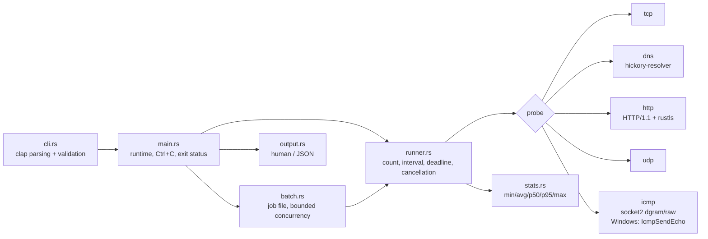
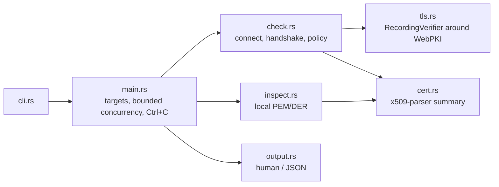

# Architecture overview

## Workspace layout

```text
rust-netutils/
├── crates/
│   ├── net-common/   private (publish = false): exit statuses, duration and endpoint parsing
│   ├── netprobe/     library + binary
│   └── certwatch/    library + binary
├── docs/             architecture, utility docs, benchmark reports
└── scripts/          reproducible benchmark harnesses
```

Each utility is its own crate with its own version, changelog, tests and release tag (`<crate>-vX.Y.Z`). Shared code goes into `net-common` only when more than one utility uses it; there are no dependencies between utilities.

## netprobe



### Design decisions

| Decision | Reason |
|---|---|
| Logic lives in the library; `main.rs` is a thin wrapper | Integration tests and benchmarks call the same code paths as the CLI. |
| Tokio current-thread runtime | Probes are I/O-bound. One thread keeps startup at about 4.6 ms and memory low. |
| Hand-written HTTP/1.1 client instead of hyper/reqwest | The probe needs one request and the response head. A small client gives exact per-phase timing and a smaller dependency tree. |
| Deadline enforced in the runner; UDP and ICMP enforce their own | A generic deadline turns a hang into "timed out". UDP needs silence to mean *inconclusive*, so it handles its own timeout and the runner allows a grace period. |
| Three outcomes (`ok` / `failed` / `inconclusive`) and exit code 3 | Prevents reporting UDP silence as either open or closed. |
| `unsafe_code = "deny"`, one documented exception | Socket setup goes through `socket2`'s safe API. The only `unsafe` is Windows ICMP FFI (`icmp_windows.rs`), which is the only way to ping on Windows without Administrator rights. |

## certwatch



| Decision | Reason |
|---|---|
| `RecordingVerifier` wraps the real WebPKI verifier and records its verdict | One handshake gives both the chain and the exact validation error, so expired or untrusted chains can still be inspected. No data is sent, and failures are always reported. |
| `x509-parser` for certificate details; `ring` for fingerprints | Mature parser; `ring` is already in the tree through rustls. |
| Separate `Warning` exit code (4) | CI can treat "expiring soon" differently from "broken". |
| Dates formatted with an internal civil-calendar routine | Avoids a date/time dependency for a single conversion. |
