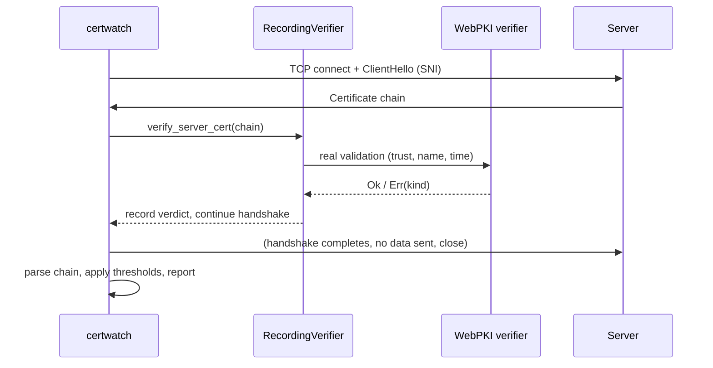

# certwatch

TLS certificate inspection and expiry monitoring. `certwatch` connects to TLS endpoints, validates the presented chain exactly as a client would, and reports the certificate details and an exit code you can use in CI or cron.

<details>
<summary><strong>Contents</strong></summary>

- [Why](#why)
- [Commands](#commands)
- [Verdicts and exit codes](#verdicts-and-exit-codes)
- [Options](#options)
- [JSON output](#json-output)
- [Recipes](#recipes)
- [Platform notes](#platform-notes)
- [Limitations](#limitations)
- [How it works](#how-it-works)

</details>

## Why

`openssl s_client` and `openssl x509` can answer every question, but they are hard to script and slow when you have many endpoints. `certwatch`:

- checks many endpoints concurrently from one process;
- distinguishes **expiring**, **expired**, **untrusted**, **hostname mismatch** and **incomplete chain**;
- shows the presented chain even when validation fails;
- includes intermediate certificates in expiry checks;
- prints human or JSON output and uses distinct exit codes for *warning* and *failure*.

## Commands

### `check`

```sh
certwatch check example.com                      # port 443 by default
certwatch check mail.example.com:993 db.internal:5432 -j 50
certwatch check -f endpoints.txt --warn-days 21 --crit-days 7
certwatch check 10.0.0.5:8443 --sni api.example.com   # connect to an IP, validate a name
```

Targets are `HOST[:PORT]` or `[IPv6]:PORT`. `--file` reads one target per line (`#` comments; `-` for stdin).

For an IP target without `--sni`, the IP address is validated against the certificate's IP SANs.

**Example: incomplete chain** (the server omits its intermediate certificate):

```console
$ certwatch check incomplete-chain.badssl.com
CRITICAL incomplete-chain.badssl.com:443  expires in 33 day(s) (2026-12-28)  subject: CN=*.badssl.com  TLS 1.2
         ! untrusted: unknown issuer (incomplete chain, private CA, or self-signed)
```

**Verbose output** shows the whole presented chain:

```console
$ certwatch check github.com -v
OK       github.com:443  expires in 63 day(s) (2027-01-27)  subject: CN=github.com  TLS 1.3
         sni=github.com addr=140.82.121.4:443
         [0] CN=github.com
             issuer:  C=GB, O=Sectigo Limited, CN=Sectigo Public Server Authentication CA DV E36
             valid:   2026-10-30T00:00:00Z .. 2027-01-27T23:59:59Z (63 days left)
             key:     EC 256  sig: ecdsa-with-SHA256
             sha256:  7D:C4:D8:5C:...:27:76
             SANs:    github.com, www.github.com
         [1] C=GB, O=Sectigo Limited, CN=Sectigo Public Server Authentication CA DV E36
             ...
```

### `inspect`

```sh
certwatch inspect fullchain.pem
certwatch inspect server.der -v
```

Reads PEM bundles (all `CERTIFICATE` blocks) or a single DER certificate, up to 16 MiB per file. It applies the same expiry thresholds and weakness checks. Trust is **not** evaluated for local files.

## Verdicts and exit codes

| Verdict | When | Exit |
|---|---|---|
| `OK` | Chain is valid and nothing expires within `--warn-days`. | 0 |
| `WARNING` | Valid, but a certificate in the chain expires within `--warn-days`. | 4 |
| `CRITICAL` | Validation failed (expired, not yet valid, untrusted, hostname mismatch, bad signature), or a certificate expires within `--crit-days`. | 1 |
| `ERROR` | No certificate could be obtained: DNS failure, connection refused, timeout, handshake failure. | 1 |
| — | Invalid usage. | 2 |

With several targets, the exit code is the most severe result. The expiry check uses the earliest expiry among the presented certificates, excluding a self-signed root if the server sends one. A problem with an intermediate is reported as "a certificate in the chain".

Weaknesses are listed but do not change the verdict:
- a SHA-1 signature on a non-self-signed certificate;
- an RSA key under 2048 bits.

## Options

| Option | Default | Meaning |
|---|---|---|
| `-w, --warn-days` | 30 | Warning threshold. |
| `-C, --crit-days` | 7 | Critical threshold. Must be ≤ `--warn-days`. |
| `--sni NAME` | target host | Server name to send and validate. |
| `--ca-file PEM` | — | Additional trusted CAs (for example, a private PKI). |
| `--no-system-roots` | off | Trust only `--ca-file`. |
| `-t, --timeout` | `5s` | Deadline per target (resolve + connect + handshake). |
| `-j, --concurrency` | 20 | Maximum targets in flight (1–1024). |
| `-f, --file` | — | Read targets from a file or stdin. |
| `--json` / `-q` / `-v` | — | JSON output / only non-OK results and the summary / full chain. |

## JSON output

```json
{
  "version": 1,
  "results": [
    {
      "target": "example.com:443",
      "verdict": "ok",
      "address": "104.20.23.154:443",
      "sni": "example.com",
      "tls_version": "TLS 1.3",
      "trusted": true,
      "days_left": 89,
      "chain_days_left": 89,
      "chain": [
        {
          "subject": "CN=example.com",
          "issuer": "C=US, O=...",
          "sans": ["example.com", "*.example.com"],
          "serial": "...",
          "not_before": "2026-11-24T00:00:00Z",
          "not_after": "2027-02-22T23:59:59Z",
          "days_left": 89,
          "key": "EC 256",
          "signature_algorithm": "ecdsa-with-SHA256",
          "is_ca": false,
          "self_signed": false,
          "sha256_fingerprint": "AB:CD:..."
        }
      ],
      "elapsed_ms": 61.2
    }
  ],
  "summary": { "total": 1, "ok": 1, "warning": 0, "critical": 0, "error": 0, "interrupted": false }
}
```

On failure, `trusted` is `false`, and `validation_error_kind` is one of:
- `expired`
- `not_yet_valid`
- `hostname_mismatch`
- `untrusted`
- `revoked`
- `bad_signature`
- `invalid`

`problems` lists human-readable messages. Results are in input order.

## Recipes

**Fail a CI job if a production certificate expires within 14 days:**

```sh
certwatch check -f prod-endpoints.txt --warn-days 30 --crit-days 14 -q
```

**Nightly cron with a JSON report:**

```sh
certwatch check -f endpoints.txt --json > /var/lib/certwatch/$(date +%F).json || alert
```

**Internal PKI:**

```sh
certwatch check vault.internal:8200 --ca-file /etc/pki/internal-root.pem --no-system-roots
```

## Platform notes

- Trust anchors come from the operating system store (`rustls-native-certs`): the system CA bundle on Linux, the Keychain on macOS, and the certificate store on Windows.
- CI builds and tests on Linux (x86_64, ARM64), Windows (x86_64, ARM64) and macOS (Apple Silicon). macOS x86_64 is cross-compiled only.

## Limitations

- No STARTTLS (SMTP, IMAP, PostgreSQL and so on): the target must speak TLS directly.
- Revocation (OCSP/CRL) is not checked.
- Certificate Transparency is not checked.
- Only the first address that accepts a connection is checked, not every A/AAAA record.
- Clients using rustls do not negotiate TLS 1.0 or 1.1 or old cipher suites, so servers that support only those report a handshake `ERROR`.

## How it works



The handshake is allowed to finish even when validation fails, so the chain can be inspected. No application data is ever sent, and a failed validation is always reported as `CRITICAL`. Handshake signatures are always verified for real.
