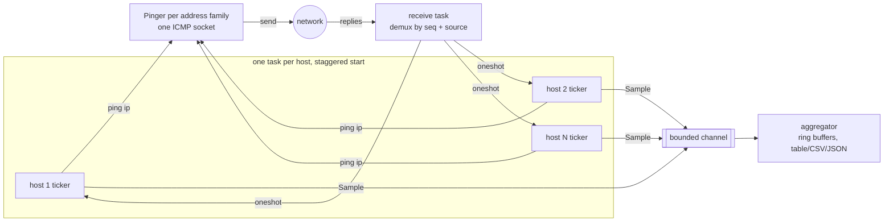

# meshping

Continuous multi-host latency and loss monitoring. meshping probes many hosts in parallel at a fixed cadence and keeps rolling statistics per host. It prints a periodic table or streams every sample as CSV or JSON.

<details>
<summary><strong>Contents</strong></summary>

- [Why](#why)
- [Usage](#usage)
- [Modes: ICMP and TCP](#modes-icmp-and-tcp)
- [Options](#options)
- [Statistics](#statistics)
- [Output](#output)
- [Exit codes](#exit-codes)
- [Recipes](#recipes)
- [Platform notes](#platform-notes)
- [Limitations](#limitations)
- [How it works](#how-it-works)

</details>

## Why

`ping` watches one host; `fping` covers many but prints raw lines that need post-processing. meshping gives you:
- a live table of loss, min/avg/p95/max and jitter for hundreds of hosts;
- machine-readable per-probe output;
- a TCP mode for networks where ICMP is blocked or not permitted, always labelled as TCP and never mixed with ICMP numbers.

## Usage

```sh
meshping 10.0.0.1 10.0.0.2 gw.branch.example        # until Ctrl+C, table every 10s
meshping -f fleet.txt -i 5s -r 1m                   # host file, probe every 5s, report every minute
meshping -f fleet.txt -c 60 -o csv > latency.csv    # 60 probes per host, CSV export
meshping db.internal:5432 api.internal:443 -m tcp   # TCP connect latency to service ports
```

Host files contain one `HOST` or `HOST:PORT` per line; `#` starts a comment.

## Modes: ICMP and TCP

| Mode | Measures | Needs |
|---|---|---|
| `icmp` | ICMP echo round trip | Linux: group within `net.ipv4.ping_group_range`, or root/`CAP_NET_RAW`. macOS: unprivileged. Windows: unprivileged (IP Helper API). |
| `tcp` | TCP connect time to `HOST:PORT` (default port `--tcp-port 443`) | Nothing |
| `auto` (default) | ICMP if permitted, otherwise TCP | — |

In TCP mode, both a completed handshake and a refusal (RST) prove the host answered, and both are timed. Only silence or local errors count as loss. TCP connect time includes kernel and server accept work, so it is **not directly comparable** with ICMP RTT. That is why every row and record carries its `mode`, and `auto` announces the fallback on stderr.

## Options

| Option | Default | Meaning |
|---|---|---|
| `-f, --hosts FILE` | — | Read hosts from a file (`-` = stdin). |
| `-m, --mode` | `auto` | `auto`, `icmp`, `tcp`. |
| `-p, --tcp-port` | 443 | Port for TCP mode when a host has none. |
| `-i, --interval` | `1s` | Time between probes to each host. |
| `-t, --timeout` | min(1s, interval) | Probe timeout; must not exceed the interval. |
| `-c, --count` | unlimited | Probes per host, then exit. |
| `-w, --window` | 60 | Samples per host in the rolling window. |
| `-o, --output` | `table` | `table`, `csv`, `json`. |
| `-r, --report` | `10s` | Table refresh interval. |
| `-q, --quiet` | off | No final summary (CSV/JSON). |

Hostnames are resolved once at start-up, and probes then go to that fixed address. Up to 10,000 hosts are supported.

## Statistics

Per host:

| Column | Scope | Meaning |
|---|---|---|
| SENT | lifetime | Probes sent. |
| LOSS% | lifetime | Probes without a reply. |
| LAST | — | Most recent successful RTT. |
| MIN / AVG / P95 / MAX | rolling window | Over the last `--window` samples. P95 uses the nearest-rank method. |
| JITTER | rolling window | Mean absolute difference between consecutive successful RTTs. |

JSON/CSV consumers can compute any other statistic from the per-probe stream.

## Output

**CSV** (`-o csv`):

```text
time,host,mode,seq,rtt_ms,status
2026-11-25T13:28:07Z,1.1.1.1:53,tcp,0,24.935,ok
2026-11-25T13:28:08Z,1.1.1.1:53,tcp,1,,"timeout"
```

**JSON Lines** (`-o json`):

```json
{"time":"2026-11-25T13:28:07Z","host":"1.1.1.1","mode":"icmp","seq":0,"rtt_ms":15.97,"error":null}
```

For CSV and JSON, the final summary table goes to stderr.

## Exit codes

| Code | Meaning |
|---|---|
| 0 | Every host answered at least once (or Ctrl+C with that condition). |
| 1 | At least one host never answered, a host could not be resolved, or ICMP was requested but is not permitted. |
| 2 | Usage error. |

## Recipes

```sh
# Branch office links: alert on loss above 5% using the JSON stream.
meshping -f branches.txt -o json -q | jq -c 'select(.rtt_ms == null)'

# VPN path quality for a change window, kept as evidence.
meshping vpn-gw-a vpn-gw-b -i 200ms -c 3000 -o csv > vpn-$(date +%F).csv

# ICMP blocked? Measure the service port instead.
meshping -m tcp api.example.com:443 db.example.com:5432
```

## Platform notes

- **Linux**: enable unprivileged ICMP with `sudo sysctl -w net.ipv4.ping_group_range="0 2147483647"`. Otherwise use `sudo`, `CAP_NET_RAW`, or TCP mode.
- **Windows**: ICMP uses `IcmpSendEcho`/`Icmp6SendEcho2`, one blocking call per probe on Tokio's blocking pool.
- CI builds and tests on Linux, Windows and macOS. The deterministic tests use TCP mode, because ICMP permission differs between CI runners.

## Limitations

- No TUI and no outage-event detection yet (both planned).
- Hostnames are resolved once at start-up; DNS changes during a run are not followed.
- Packet size and TTL are not configurable.

## How it works



**Shared ICMP socket.** With raw sockets, the kernel delivers every ICMP packet on the host to every raw socket. A socket per host would make the cost per packet grow with the number of hosts. meshping uses one socket per address family and a single receive task that routes replies by sequence number, checking the source address as well.
