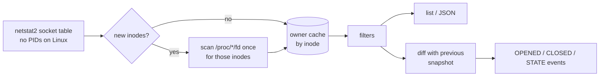

# portwatch

Inspect TCP and UDP sockets, listening ports and their owning processes, and watch them change. One interface across Linux, Windows and macOS.

<details>
<summary><strong>Contents</strong></summary>

- [Why](#why)
- [Usage](#usage)
- [Filters](#filters)
- [Watch mode](#watch-mode)
- [Output](#output)
- [Exit codes](#exit-codes)
- [Permissions](#permissions)
- [Platform notes](#platform-notes)
- [Limitations](#limitations)
- [How it works](#how-it-works)

</details>

## Why

`ss`, `netstat`, `lsof -i` and `Get-NetTCPConnection` all answer "what's on this port?", each with different flags and output on each OS. portwatch gives you:
- one CLI on every platform;
- filters that compose;
- an exit status that works directly in scripts;
- JSON output;
- a watch mode that reports *changes* instead of reprinting tables.

## Usage

```sh
portwatch                         # all TCP and UDP sockets
portwatch -l                      # listening TCP + bound UDP
portwatch -p 8080                 # anything with local or remote port 8080
portwatch -L 5432 -s established  # established connections to the local Postgres port
portwatch -n nginx -l             # what is nginx listening on? (Linux process names)
portwatch --pid 4121 --json       # one process's sockets as JSON
```

## Filters

All filters combine with AND. A comma-separated list within one filter matches any of its values.

| Option | Matches |
|---|---|
| `-p, --port N[,N]` | local **or** remote port |
| `-L, --local-port N[,N]` | local port only |
| `--pid N[,N]` | owning process ID |
| `-n, --process NAME` | process name contains NAME (case-insensitive; Linux) |
| `-a, --address IP` | local or remote IP |
| `-s, --state S[,S]` | TCP state: `LISTEN`, `ESTABLISHED`, `TIME_WAIT`, `CLOSE_WAIT`, `SYN_SENT`, `SYN_RCVD`, `FIN_WAIT_1`, `FIN_WAIT_2`, `CLOSING`, `LAST_ACK`, `CLOSED`. Implies TCP. |
| `-l, --listening` | listening TCP sockets and bound UDP sockets |
| `-t` / `-u` | TCP only / UDP only |
| `-4` / `-6` | IPv4 only / IPv6 only |

## Watch mode

```sh
portwatch --watch -l                 # new listeners appearing or disappearing
portwatch --watch -p 443 --json      # connection churn on 443 as JSON Lines
```

Every `--interval` (default 1s), a new snapshot is compared with the previous one, and these events are printed:
- `OPENED`: a socket appeared;
- `CLOSED`: a socket disappeared;
- `STATE`: a TCP state transition, shown with the previous state.

Sockets are identified by (protocol, local address, remote address). Connections that open and close within one interval are not seen; this is polling, not packet capture.

## Output

```json
{"version":1,"count":1,"sockets":[
  {"proto":"tcp","local":"127.0.0.1:4226","remote":"0.0.0.0:0","state":"LISTEN","pids":[87145],"process":"sccache"}]}
```

Watch events (JSON Lines): `{"event":"opened|closed|state","socket":{…},"previous":"ESTABLISHED","time":"…Z"}`. `previous` is present only for `state` events.

## Exit codes

| Code | Meaning |
|---|---|
| 0 | At least one socket matched (listing), or watch was stopped. |
| 1 | No socket matched, or the socket table could not be read. |
| 2 | Usage error. |

```sh
portwatch -L 8080 -l -q && echo "port 8080 is taken"
```

## Permissions

Any user can see the socket table. Owning PIDs for **other users'** processes need elevated privileges: root or `CAP_SYS_PTRACE`/`CAP_DAC_READ_SEARCH` on Linux, root on macOS, and an elevated prompt on Windows for some system processes. Without them, the PID column shows `-`, and portwatch prints a note on stderr saying how many owners are unknown. It never hides those sockets.

## Platform notes

| | Linux | Windows | macOS |
|---|---|---|---|
| Socket table | netlink `sock_diag` | IP Helper (`GetExtendedTcpTable`/`UdpTable`) | libproc |
| Owning PID | `/proc/*/fd` scan, cached by inode | from the table | libproc |
| Process name | `/proc/<pid>/comm` | not yet | not yet |

Socket tables come from the [`netstat2`](https://crates.io/crates/netstat2) crate. Correctness on Linux was checked against `ss`: identical socket counts for TCP, UDP and listening sockets, and identical PID coverage as root. CI builds and tests on Linux, Windows and macOS.

## Limitations

- Process names only on Linux.
- Sockets bound to the same address on different interfaces (`SO_BINDTODEVICE`) are listed separately but share one identity in watch mode.
- No TUI yet; no per-socket byte counters.
- **CPU in watch mode**: each poll dumps the kernel's socket tables. On Linux, the kernel walks the whole TCP hash table, whose size scales with installed RAM, not with the number of sockets. On the 62 GiB reference host, each poll costs about 40 ms of kernel time (two dumps, IPv4 and IPv6, comparable to one `ss -tan`), so `--watch -i 1s` uses about 6% of a core even when idle. Raise `--interval`, or use `-4`/`-6`, to reduce it.

## How it works


